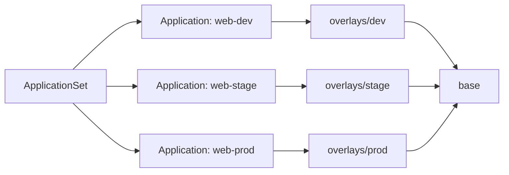

# Argo CD ApplicationSet with Kustomize overlays

Hand-copying the same app into dev, stage and prod configs lets the environments
drift apart over time. Each one ends up patched a little differently by hand, and
nobody is quite sure which overlay is "right" anymore. Promoting to prod is a
manual, error-prone sync because there's no single place that defines all three
environments together.

This repo fixes that with one ApplicationSet that generates one Argo CD
Application per environment, each pointing at a Kustomize overlay over a shared
base.

## Flow

## Environments

| environment | replicas | sync mode | cluster placeholder |
|-------------|----------|-----------|----------------------|
| dev         | 1        | auto-sync, prune, self-heal | https://dev.example.com |
| stage       | 2        | auto-sync, prune, self-heal | https://stage.example.com |
| prod        | 3        | manual                      | https://prod.example.com |

## Usage

To add a fourth environment:

1. Add one element to the `elements` list in [applicationset.yaml](applicationset.yaml)
   with its `env`, `clusterURL` and `autosync`.
2. Add a matching `overlays/<env>/` directory with a `kustomization.yaml`, a
   replica patch and an image tag.

That's it — the ApplicationSet picks up the new element and renders the
matching Application.

## Promoting a tag

Bump `newTag` in `overlays/dev/kustomization.yaml`, let dev auto-sync, then repeat
in `overlays/stage`. Once stage looks good, bump `overlays/prod` and sync it manually.

## Status

Tested with kustomize build, kubeconform and a rendered-output test only. Not
applied to any Argo CD instance.

## Known limitations

- The ApplicationSet is not run against a real Argo CD.
- Cluster URLs are placeholders.
- Secrets are not handled.
- Sync waves and progressive rollout are not included.

## Runtime security

Workloads use a non-root UID/GID, RuntimeDefault seccomp, a read-only root filesystem, no privilege escalation and no Linux capabilities. An `emptyDir` at `/tmp` supplies writable runtime storage. These are configuration defaults, validated with rendered manifests and schema checks in CI; no real cluster execution is claimed.

Nginx listens on unprivileged port 8080; Service port 80 maps to it. Its mounted configuration keeps PID and temporary files under `/tmp` and bypasses the image entrypoint scripts. CI also checks `nginx -t` with the same non-root/read-only constraints.
